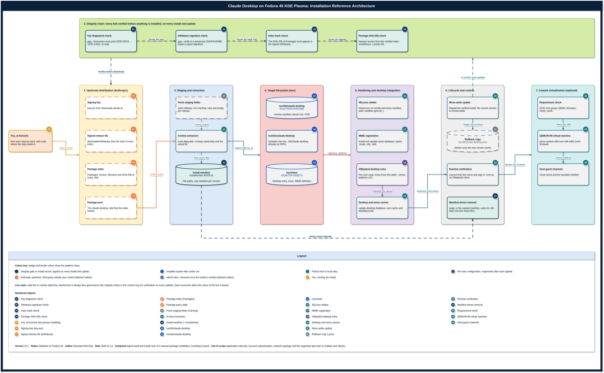

# Installing Claude Desktop on Fedora 44 KDE

**A manual installation guide for an officially unsupported platform, with integrity verification and a clean removal path.**

| | |
|---|---|
| **Target platform** | Fedora 44 Workstation, KDE Plasma 6 |
| **Architecture** | x86_64 (the arm64 route is identical, with one substitution) |
| **Upstream package** | `claude-desktop_amd64.deb`, Anthropic's official Linux beta |
| **Support status** | Unsupported by Anthropic on Fedora. This is a community procedure. |
| **Author** | NeumannTechTips |
| **Last validated** | 8 August 2026, end to end on real hardware, download through sign-in |

---

## Why this guide exists

Anthropic shipped a Linux beta of Claude Desktop as a Debian package, distributed through its own apt repository. The official documentation is clear about the boundary: Ubuntu 22.04 or later and Debian 12 or later are supported, on x86_64 or arm64, and support for other distributions is described as coming in the future. Fedora and RHEL are named explicitly as not supported today.

That leaves Fedora users with three options. Wait for a native RPM. Use a third-party repackage. Or extract the official package and place its contents where a package manager would have put them.

This guide covers the third option, because it has one property the others lack: the bytes you install are Anthropic's own, unmodified, and you can prove it before anything touches your system. The trade-off is that `dnf` has no record of the result, so updates and removal become your responsibility rather than the package manager's.

If that trade-off does not appeal, two alternatives are worth considering first. A community project maintains RPM and AppImage repackages of the same official `.deb`, which restores update handling at the cost of trusting an intermediary. Alternatively, the Claude Code CLI has a native Fedora installer and an official RPM repository from Anthropic, and it runs the same engine as the Code tab in the desktop app. For terminal-centred work, the CLI may be all you need.

## Before you start

You will need roughly 1 GB of free space on the `/usr` filesystem, an active internet connection, and `sudo` rights. The application is Electron-based, so treat its memory appetite as comparable to a browser or a modern editor.

Everything below runs from a terminal. Konsole is fine.

---

## Step 1: Confirm your architecture

```bash
uname -m
```

`x86_64` means you want the amd64 package, which is what the rest of this guide assumes. If you see `aarch64`, substitute `arm64` wherever `amd64` appears. No other step changes.

## Step 2: Install dpkg

Fedora cannot install `.deb` packages, but it does ship the `dpkg` toolchain, which is all you need to read one:

```bash
sudo dnf install -y dpkg
```

This installs an extraction tool, not a second package manager. Nothing about your system's package management changes.

## Step 3: Create a working directory

Keep the download, the staging tree and the manifest together. This matters later, when you need to remove or update the application:

```bash
mkdir -p ~/claude-desktop-install && cd ~/claude-desktop-install
```

## Step 4: Download the package

The cleanest approach uses Anthropic's published command, which reads the repository index, finds the newest package for your architecture, and downloads it:

```bash
curl -fLO "https://downloads.claude.ai/claude-desktop/apt/stable/$(curl -s "https://downloads.claude.ai/claude-desktop/apt/stable/dists/stable/main/binary-$(dpkg --print-architecture)/Packages" | grep '^Filename: pool/main/c/claude-desktop/claude-desktop_' | sort -V | tail -n 1 | cut -d' ' -f2)"
```

If that command reports `Remote file name has no length`, the index lookup returned nothing. Confirm your network can reach `downloads.claude.ai` and that `dpkg --print-architecture` prints `amd64` or `arm64`.

You can also download through the browser from the Claude download page, though you will then need to locate the saved file yourself. Whichever route you take, confirm you have a real package before continuing:

```bash
ls -lh claude-desktop*.deb
file claude-desktop*.deb
```

Expect a file in the region of 160 MB, reported as a Debian binary package. If `file` says HTML, you have downloaded an error page rather than the application.

## Step 5: Verify what you downloaded

This step is the reason the manual route can be done responsibly, so please do not skip it.

When apt installs a package, it verifies a cryptographic chain on your behalf. The repository's release file is signed by Anthropic's key, that release file commits to the package index, and the index carries a SHA-256 digest for every package. Extracting a `.deb` by hand bypasses all of it. You are running 160 MB of code, much of it setuid-adjacent, on the strength of a URL. Reconstructing the checks by hand takes about a minute.

### Verify the signing key

```bash
curl -fsSLo claude-desktop-key.asc https://downloads.claude.ai/claude-desktop/key.asc
gpg --show-keys claude-desktop-key.asc
```

The fingerprint printed must be:

```
31DD DE24 DDFA B679 F42D  7BD2 BAA9 29FF 1A7E CACE
```

If it differs, stop. Do not extract the package. Anthropic publishes this fingerprint in its own installation documentation, which is what makes it usable as an independent reference point.

### Verify the package digest

```bash
ARCH=$(dpkg --print-architecture)
BASE="https://downloads.claude.ai/claude-desktop/apt/stable"
curl -fsSLo Packages "$BASE/dists/stable/main/binary-$ARCH/Packages"
awk '/^Package: claude-desktop$/,/^$/' Packages | grep -E '^(Version|Filename|SHA256):'
```

That prints the published digest for each version in the index. Now compute the digest of your download:

```bash
sha256sum claude-desktop*.deb
```

The two values must match. A mismatch means the file was corrupted in transit or is not the package the repository published, and either way it should not be installed.

### Verify the index itself, if you want the full chain

The digest check above is only as trustworthy as the index it came from. To close that gap, verify the repository's signed release file against the key you already checked:

```bash
gpg --no-default-keyring --keyring ./claude-trust.gpg --import claude-desktop-key.asc
curl -fsSLo InRelease "$BASE/dists/stable/InRelease"
gpg --no-default-keyring --keyring ./claude-trust.gpg --verify InRelease
```

This uses a local, throwaway keyring rather than importing an unrelated key into your personal one. A good signature from the Anthropic key completes the chain: signature to release file, release file to index, index to package.

One honest caveat. The `InRelease` path follows the standard Debian repository layout rather than a path published in Anthropic's documentation. If it returns a 404, try `dists/stable/Release` together with `dists/stable/Release.gpg` instead, which is the older equivalent. The digest check in the previous section remains valid either way, since its path is documented.

## Step 6: Extract the package

Extract as root. This matters more than it appears to:

```bash
sudo dpkg-deb -x claude-desktop*.deb extracted/
```

Running the extraction under `sudo` preserves the root ownership and permission bits recorded inside the archive, including the setuid bit on the Chromium sandbox helper. Extract as a normal user and every file becomes yours, which breaks the sandbox and forces you to repair permissions afterwards. Getting this right here saves two troubleshooting steps later.

## Step 7: Record an install manifest

`dnf` will not know these files exist, so write down what you are about to install before you install it:

```bash
sudo find extracted/usr \( -type f -o -type l \) | sed 's|^extracted||' | sudo tee installed-files.txt > /dev/null
wc -l installed-files.txt
```

Note the `-type l` clause. The application's launcher at `/usr/bin/claude-desktop` is a symbolic link, not a regular file, and a manifest built with `-type f` alone would silently omit it. That omission only surfaces months later, when an incomplete uninstall leaves a broken link behind.

## Step 8: Copy into place

```bash
sudo cp -a extracted/usr/. /usr/
```

The `-a` flag is doing real work here. It preserves ownership, permission bits and symbolic links exactly as extracted. A plain `cp` does neither of two things you need: it drops the setuid bit as a deliberate safety measure, and it applies your shell's umask to everything it creates. On a hardened Fedora install with a restrictive umask, that combination produces an application that either cannot start or cannot be read by your own user account. The troubleshooting section covers the symptoms if you have already hit this.

Confirm the result:

```bash
ls -la /usr/bin/claude-desktop
ls -la /usr/lib/claude-desktop/chrome-sandbox
```

The first should be a symbolic link pointing into `../lib/claude-desktop/`. The second must read `-rwsr-xr-x`, with an `s` in the owner-execute position. That `s` is the setuid bit, and Chromium's sandbox will not initialise without it.

## Step 9: Refresh the Plasma menu

KDE caches its list of installed applications, so a desktop entry placed directly on disk stays invisible until the cache is rebuilt:

```bash
kbuildsycoca6
```

On Plasma 5, use `kbuildsycoca5` instead. There is no output on success.

## Step 10: Launch

```bash
claude-desktop
```

Run it in the foreground the first time rather than backgrounding it with `&`, so that any startup error reaches your terminal instead of disappearing into job control.

`/usr/bin` is already on the `PATH` of every user on a standard Fedora system, so there is nothing to add to your shell profile and nothing that resets on reboot. The command works from any directory, in any new terminal, permanently.

You should now also find Claude in the Plasma application launcher, with its icon. Right-click it there to pin it to your task manager or favourites if you would rather not use a terminal at all.

Sign in with your Anthropic account. Chat is available on every plan including Free. Claude Code and Cowork require Pro, Max, Team or Enterprise.

---

## Native Wayland sessions: one additional flag

Fedora's KDE spin defaults to a native Wayland session, and Claude Desktop's Chromium base has two known rough edges under native Wayland that do not appear under X11 or under XWayland. Neither is dangerous, but both are worth heading off before they look like a broken install.

Test it directly first:

```bash
claude-desktop --ozone-platform=x11
```

If the welcome screen appears and you see:

```
ERROR:media/gpu/vaapi/vaapi_wrapper.cc: vaInitialize failed: unknown libva error
```

or a line mentioning `dri_gbm.so` and `Permission denied`, that is expected and covered below in Troubleshooting. Both are cosmetic. If the window opens, the flag works and the install is functioning correctly.

Make it permanent without editing Anthropic's own desktop file, since that file is overwritten on every future update. Write a user-level override instead, which KDE's XDG lookup rules read ahead of the system one:

```bash
mkdir -p ~/.local/share/applications
cp /usr/share/applications/com.anthropic.Claude.desktop ~/.local/share/applications/
sed -i 's|^Exec=claude-desktop|Exec=claude-desktop --ozone-platform=x11|' ~/.local/share/applications/com.anthropic.Claude.desktop
kbuildsycoca6
```

Confirm all three `Exec=` lines picked up the flag, the main entry plus the two quick actions:

```bash
grep ^Exec= ~/.local/share/applications/com.anthropic.Claude.desktop
```

You should see `--ozone-platform=x11` on every line. This makes the flag apply automatically from the application launcher and from Quick Entry, not only when launched by hand from a terminal.

If you're on an X11 session rather than Wayland, or you're using XWayland, none of this is necessary. Check with:

```bash
echo $XDG_SESSION_TYPE
```

---

## Desktop integration extras

Two optional packages fix issues that only appear on some setups.

If the system tray icon does not appear:

```bash
sudo dnf install -y libayatana-appindicator-gtk3
```

If you run a Wayland session and the Quick Entry global hotkey does nothing, it needs KDE's global shortcuts portal. Fedora's KDE spin normally ships this already, so check before installing:

```bash
sudo dnf install -y xdg-desktop-portal-kde
```

The hotkey works without extra configuration on X11.

---

## Troubleshooting

### `command not found` after a successful copy

The copy did not complete. It is easy to miss, because `cp` can fail partway with very little to say for itself. Re-run the copy verbosely and read the output:

```bash
cd ~/claude-desktop-install
sudo cp -av extracted/usr/. /usr/
```

Then confirm the symlink exists at `/usr/bin/claude-desktop`.

### `vaInitialize failed` on launch

```
ERROR:media/gpu/vaapi/vaapi_wrapper.cc:1658 vaInitialize failed: unknown libva error
```

Hardware video decode is unavailable, and Chromium falls back to software decoding automatically. This affects only embedded video playback inside the app, nothing else, and does not prevent the app from starting. Safe to ignore unless you specifically need hardware-accelerated video.

### `dri_gbm.so: Permission denied` on launch, despite correct file permissions

```
MESA-LOADER: failed to open dri: /usr/lib64/gbm/dri_gbm.so: cannot open shared object file: Permission denied
```

This looks alarming because "Permission denied" usually means a Unix permissions or SELinux problem, and it is worth ruling both out properly rather than guessing, in this order:

**1. Check the file itself.** It should already be correct, since this is a stock Fedora system library your install never touched:

```bash
ls -la /usr/lib64/gbm/dri_gbm.so
```

Expect `-rwxr-xr-x root root`, world-readable and world-executable. If that is what you see, standard Unix permissions are not the cause.

**2. Check SELinux properly, not just with `getenforce`.** A denial can only be ruled out by actually finding no denial logged, which depends on `auditd` running:

```bash
systemctl is-active auditd
sudo ausearch -m avc -ts recent
```

If `ausearch` returns `<no matches>` **and** `auditd` is active, that is a genuine negative, SELinux is not involved. If `auditd` is inactive, `ausearch` will report no matches regardless of what happened, so check the kernel ring buffer directly instead:

```bash
sudo dmesg | grep -i denied
sudo journalctl -k -g denied
```

Empty results across all of these mean SELinux genuinely is not the cause, and no `restorecon` or policy change is needed.

**3. The actual cause: Chromium's internal GPU sandbox, not the OS.** Independently of the setuid `chrome-sandbox` helper fixed during installation, Chromium's GPU process applies its own internal restriction on which library paths it will open. The package is built assuming Debian's multiarch layout (`/usr/lib/x86_64-linux-gnu/...`), and Fedora uses `/usr/lib64/...` instead. The library is present and its permissions are correct, but the sandboxed GPU process does not recognise that path as one it is allowed to touch, and reports the refusal back as a permission failure rather than a missing-file one.

To confirm this specifically, as a one-off diagnostic only:

```bash
claude-desktop --ozone-platform=x11 --disable-gpu-sandbox
```

If the `dri_gbm.so` line disappears, that confirms the cause. **Do not leave this flag on permanently.** It disables a real security boundary around a process that renders remote content, for the sake of a cosmetic rendering path. The practical effect of the original error, with the flag left off, is that the app falls back to software rendering (`llvmpipe`). Chat, Cowork and Claude Code all function normally under software rendering; you lose GPU-accelerated compositing, nothing more.

### `Permission denied` when listing files under `/usr/lib/claude-desktop`

Your umask stripped the world-execute bit from the directory when it was created. Reading a file requires execute permission on every directory above it, so a directory at `drwxr-x---` blocks your own user account from reaching anything inside.

Diagnose it precisely rather than guessing which directory is at fault:

```bash
umask
namei -l /usr/lib/claude-desktop/chrome-sandbox
```

`namei` prints the permissions of every component in the path, so the offending directory is obvious. A umask of `0027` is the usual culprit: it removes all "other" permissions from anything the process creates, and `sudo` inherits the umask of your interactive shell.

Since the umask only ever stripped the "other" bucket and left "group" alone, mirroring group onto other restores exactly what was lost:

```bash
sudo chmod -R o=g /usr/lib/claude-desktop
sudo chmod -R o=g /usr/share/doc/claude-desktop
sudo chmod o=g /usr/share/applications/com.anthropic.Claude.desktop
sudo find /usr/share/icons/hicolor -iname 'claude-desktop.png' -exec chmod o=g {} \;
```

To avoid this on future manual installs without changing your session's umask, scope a permissive one to the single command that needs it:

```bash
(umask 022 && sudo cp -a extracted/usr/. /usr/)
```

### The application crashes immediately on launch

Check the sandbox helper's permission bits:

```bash
ls -la /usr/lib/claude-desktop/chrome-sandbox
```

If the owner-execute position shows `x` rather than `s`, the setuid bit was stripped during the copy. Restore it:

```bash
sudo chown root:root /usr/lib/claude-desktop/chrome-sandbox
sudo chmod 4755 /usr/lib/claude-desktop/chrome-sandbox
```

Resist the temptation to work around this with `--no-sandbox`. That flag disables a genuine security boundary in a browser engine that renders remote content, which is a poor trade for saving one `chmod`.

### `Broken pipe` from `dpkg-deb`

Harmless. If you piped `dpkg-deb -c` into `head`, the pipe closed once `head` had its lines while `dpkg-deb` was still writing. Nothing failed.

### Nothing in `~/Downloads`

The browser saved it elsewhere. Search rather than guess:

```bash
find ~ -maxdepth 3 -iname "*claude-desktop*.deb" 2>/dev/null
```

---

## Updating

Nothing updates automatically on this path. The desktop app has no built-in updater on Linux, and `dnf` does not know the package exists.

When a new version is released, repeat steps 4 through 9 with the fresh package. The copy overwrites the previous files in place. Re-run the integrity verification each time, because a signing key and a digest that were correct last month tell you nothing about this month's download.

## Removing

The manifest you wrote in step 7 turns removal from guesswork into an exact operation:

```bash
cd ~/claude-desktop-install
sudo xargs -a installed-files.txt rm -v
sudo rm -rf /usr/lib/claude-desktop /usr/share/doc/claude-desktop
kbuildsycoca6
```

Review `installed-files.txt` before running this. It drives `rm` with `sudo`, and a manifest generated against the wrong directory would do real damage.

---

## Known limitations of the Linux beta

Several features present on macOS and Windows are absent on Linux, independently of anything Fedora-specific:

- Computer Use, meaning application and screen control, is not available.
- Voice dictation is not available in the desktop app. The CLI supports it.
- The Quick Entry global hotkey works on X11. Under native Wayland it depends on the desktop environment's GlobalShortcuts portal.

Chat, Cowork and Claude Code are all present in the Linux beta.

On top of those, this installation method adds two of its own. You lose automatic updates, and you lose the package manager's dependency resolution, which means a future release depending on a newer system library will fail at runtime rather than being caught at install time.

---

## Reference architecture



A Type 1 board-pack view of the installation, built for print and for reading on paper rather than on screen. It runs across six layers: upstream distribution, acquisition and integrity verification, staging and extraction, target filesystem, hardening and desktop integration, and the lifecycle control plane. Layer membership is carried by row position and the caption chips down the left edge, with no swimlane containers, so the structure survives being exported flat into a slide or a PDF.

Connector line style carries the interaction pattern. Solid lines are synchronous, dotted lines are bulk or file transfer, and grey dashed lines are the control plane. Each connector carries a reference from F1 to F15, resolved in the flow-reference table on the diagram itself.

Three formats are provided. The `.png` above is the rendered view. A scalable `.svg` is included for printing or embedding at any size. The editable `.drawio` source opens in [diagrams.net](https://app.diagrams.net), the draw.io desktop application, or the VS Code extension.

| File | Use |
|---|---|
| `claude-desktop-fedora-install-architecture.png` | Viewing, and the version embedded above |
| `claude-desktop-fedora-install-architecture.svg` | Printing and scaling without quality loss |
| `claude-desktop-fedora-install-architecture.drawio` | Editing the diagram |

---

## Sources

- [Claude Desktop on Linux (beta)](https://code.claude.com/docs/en/desktop-linux), Anthropic. Supported distributions, repository configuration, signing key fingerprint, package pool lookup, and the feature gaps in the Linux beta.
- [Download Claude](https://claude.ai/download), Anthropic. Platform availability and plan requirements.
- [claude-desktop-debian](https://github.com/aaddrick/claude-desktop-debian). Community repackaging of the official Linux `.deb` into RPM, AppImage and Nix formats, for readers who would prefer a managed package over this manual route.

---

## Disclaimer

Fedora is not a supported platform for Claude Desktop. This procedure installs an official, unmodified Anthropic package by hand and is offered as a community contribution. It carries no warranty, and it is not endorsed by Anthropic. Verify the package before installing it, and keep the manifest so you can reverse the installation cleanly.

Anthropic's documentation states that support for additional distributions is planned. When a native RPM arrives, migrate to it and remove this installation using the steps above.

This is general information rather than professional advice, and the views here are the author's own rather than those of any employer or client. The procedure runs commands with elevated privileges, installs a setuid binary and writes into system paths. Read every command before you run it, and do not run it first on a machine you cannot afford to rebuild.

Full version: [DISCLAIMER.md](https://github.com/NeumannTechTips/neumanntechtips-resources/blob/main/DISCLAIMER.md)

---

## More from NeumannTechTips

This guide comes out of the work behind **[NeumannTechTips](https://www.youtube.com/@NeumannTechTips)**, a channel on practical AI for people who have to make it work inside a real organisation.

- 📺 **[youtube.com/@NeumannTechTips](https://www.youtube.com/@NeumannTechTips)** · a new video every other Thursday
- 📚 **[neumanntechtips-resources](https://github.com/NeumannTechTips/neumanntechtips-resources)** · free prompt packs and checklists, licensed CC BY 4.0, no sign up
